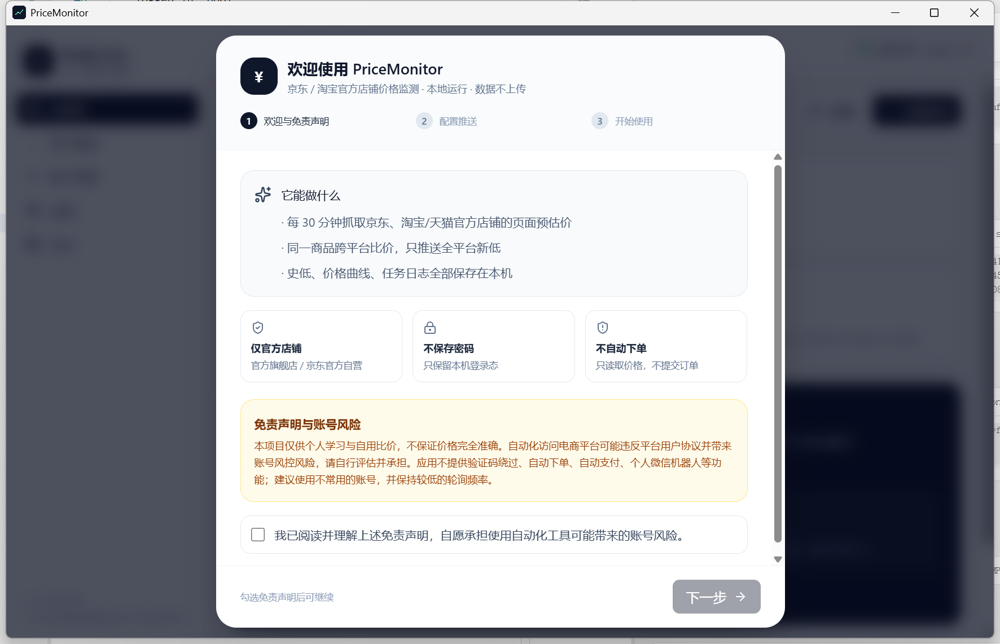

# PriceMonitor

Windows 桌面价格监测应用：监控京东、淘宝/天猫官方旗舰店（京东额外包含官方自营）指定 SKU 的页面预估价，跨平台取最低价；刷新历史最低价时通过微信推送提醒。

当前进度：**M3 发布准备（安装包与发布流程已接通）**。M0–M2 已完成，M3 正在补齐首次启动向导、桌面安装体验、发布工作流和文档。价格以页面预估价为主，自动结算已停用；详情页保留手动实付校准。



## 功能

- 京东、淘宝/天猫扫码登录、登录检查、登录态本地持久化；不保存账号密码。
- **只监控官方旗舰店**；京东额外允许官方自营。店铺名、官方标识、卖家主体和品牌一致性校验不通过时不会启用。
- 页面价、可见券、页面内嵌促销数据解析；淘宝优先读取 `__ICE_APP_CONTEXT__.sku2info.subPrice`，京东优先读取内嵌 `priceFloor.ext.jdPrice` / `promov2` / `seckill`，并识别「国补后价 / 券后价 / 已享 / 领后减 / 满4000减550」等最终价信息。手动刷新总会额外尝试京东桌面页，定时轮询每 6 小时最多尝试一次，其余轮次使用移动版以避免 PC 频控。
- 同一商品可绑定京东 + 淘宝多个 Listing，全平台最低价、页面史低 / 实付史低分离，详情页分平台价格曲线。
- 价格置信度只有高/低：高置信度=页面明确最终价且 SKU 确认，统一显示“页面预估价”；低置信度和降级页不写入史低、不推送。
- 30 分钟轮询（可调 10–180 分钟）、手动刷新冷却、连续失败暂停、验证码/登录失效提示；这些异常提示只在应用内显示，不占用微信推送次数。
- ServerChan 微信推送；首次启动向导内可保存 SendKey 并发送测试通知。微信推送只用于全平台史低和用户主动测试，暂停/登录失效等提醒不推送，避免浪费每天有限的次数。
- 手动“校准实付”：打开可见浏览器读取确认订单页实付款，不提交订单；自动结算和自动下单已停用。
- 托盘常驻、关闭到托盘、开机自启、单实例；安装包默认装到 D 盘，数据默认在 `D:\PriceMonitorData\`。
- 可选更新检查：安装版读取更新清单，有新版本时在“设置 → 关于”提示下载。

## 安装

从发布页（GitHub / Gitee Releases）下载 `PriceMonitor-<版本>-setup.exe`，双击安装。

- 按用户安装，不需要管理员权限；默认安装目录 `D:\PriceMonitor\App`，D 盘不存在时使用系统默认目录。
- 运行数据默认在 `D:\PriceMonitorData\`：SQLite、日志、浏览器登录态、Electron 缓存。可用环境变量 `PRICE_MONITOR_DATA_DIR` 覆盖；D 盘不可用时回退到 `%APPDATA%\PriceMonitor\`。
- 卸载默认保留数据目录，避免误删价格历史。
- 安装包未做代码签名，Windows SmartScreen 可能提示“未知发布者”；请核对发布页中的 SHA256。

首次启动会显示三步向导：免责声明与账号风险确认 → ServerChan 推送配置（可跳过）→ 登录账号 / 添加商品。向导完成后可在“设置 → 关于”重新打开。

## 使用

1. 打开“账号管理”，分别扫码登录京东、淘宝/天猫。登录窗口是可见的 Edge，应用只保存本机浏览器登录态。
2. 打开“添加商品”，输入型号/规格自动搜索京东或淘宝/天猫官方店；也可以直接粘贴商品链接。
3. 应用校验官方店铺和品牌后展示解析结果；选择内存/存储等规格并绑定到新商品或已有商品。
4. 等待自动轮询或点“刷新”。同一商品绑定多个平台后会显示全平台最低价和分平台曲线。
5. 需要核对实付价时，在商品详情页点“手动校准实付”。它只走到确认订单页读取实付款，不会提交订单。

按型号搜索同时支持京东和淘宝/天猫官方店。淘宝会先搜索品牌的天猫官方旗舰店，再在店内搜索型号并读取 SKU 规格；店铺或商品校验不通过时不会加入。淘宝风控比京东更严格，搜索可能触发登录失效或滑块验证，此时请到账号管理重新登录、完成验证，或改用“粘贴链接”。应用不会绕过验证码。

## 价格口径

- **页面预估价**：页面明确显示“补贴后 / 券后价 / 到手价”等最终价，且 SKU 已确认时，才作为高置信度价格采纳。这是主价格，用于当前价、页面史低和推送。
- **实付结算价**：只在用户手动校准后记录，用于“实付史低”参考，不覆盖页面预估价。京东移动端结算页可能跳到 `limit.html`，失败时继续使用页面预估价。
- 低置信度数据（页面价减券估算、内嵌兜底、缺 SKU 或降级页）不参与比价、不写史低、不推送。
- 史低和推送只认同一 Product 的全平台最低价；某个平台单独降价但另一平台更便宜时不推送。
- 价格仍可能与真实下单金额存在差异（跨店券、会员价、地址运费、支付优惠、未领取补贴等），最终以结算页为准。

## 数据与隐私

- 数据全部在本机，不上传云端。
- 不保存账号密码；SendKey 保存在 Windows 凭据管理器，不写入 SQLite。
- 不提交 Cookie、地址、手机号、订单号到仓库；`.gitignore` 已排除数据库、浏览器登录态和密钥文件。
- 备份：复制整个 `D:\PriceMonitorData\` 即可；SQLite 使用 WAL 模式，备份前建议退出应用。

## 常见问题

**登录后仍提示未登录 / 抓取失败？**
检查“账号管理”里显示的账号昵称是否和浏览器一致；不一致请“切换账号”。淘宝商品页通常必须先登录。登录过期会在下一轮轮询时提示。

**遇到滑块或“访问异常提示”？**
停止高频刷新，等待一段时间后手动完成验证；应用不会绕过验证码。降级页不会写入价格。

**页面预估价和结算价不一致？**
页面价包含可见优惠，但会员价、跨店券、地址运费、支付优惠等可能只在结算页生效。用“手动校准实付”核对；自动结算已停用。京东移动版商品页有时只返回京东价（例如 4899），国补后价和平台券后的价格只出现在桌面页或结算页；此时手动刷新会额外尝试桌面页，仍读不到时请用“手动校准实付”。

**京东显示的价格比浏览器里高（例如 4899 对 3848.78）？**
通常是移动版页面没有返回“国补后价 / 已享平台券”数据。应用已支持识别这些最终价标签；定时轮询每 6 小时最多尝试一次桌面页，手动刷新总会尝试；桌面页被频控时回退移动版。如果桌面页被京东频控，请用“手动校准实付”读取确认订单页的实付款，或稍后重试。

**京东结算校准失败？**
京东移动端常被 `limit.html` 风控拦截。可以稍后重试，或继续使用页面预估价；实付史低会保留上次成功结果并显示时间。

**开机自启为什么在开发模式无效？**
开发模式的可执行文件是 Electron 本身，注册启动项会启动错误的程序。安装版会在保存设置后注册 `--hidden` 自启。

**如何检查更新？**
安装版在“设置 → 关于”点“检查更新”。需要发布方在打包前配置 `resources/update.json` 的 `manifest_url`（见下文）；未配置时只显示当前版本。

**数据在哪里？如何卸载干净？**
数据在 `D:\PriceMonitorData\`。卸载程序默认不删除该目录；确认不需要历史后再手动删除。

## 从源码构建

### 环境

- Windows 10/11
- Node.js 24+ / npm 11+
- conda 环境 `pricemonitor`（Python 3.14，`D:\Anaconda\envs\pricemonitor`）
- 所有 Python 依赖和命令在该环境执行，不要使用 base 或其他 Python 环境

### 初始化

```bash
# Python 依赖（在 backend/ 下）
cd backend
uv pip install --python "D:\Anaconda\envs\pricemonitor\python.exe" -e ".[dev]"

# 前端依赖（回到项目根目录）
cd ..
npm install
```

Electron 45 使用懒下载；`npm install` 的 `postinstall` 会调用 `node_modules/electron/install.js`。如果下载失败：

```bash
ELECTRON_MIRROR="https://npmmirror.com/mirrors/electron/" node node_modules/electron/install.js
```

### 开发与检查

```bash
npm run dev

cd backend
"D:\Anaconda\envs\pricemonitor\python.exe" -m pytest
"D:\Anaconda\envs\pricemonitor\python.exe" -m ruff check .

cd ..
npm run typecheck
npm run lint
npm test
npm run build
```

### 构建安装包

```bash
npm run dist
```

`npm run dist` 会依次执行：

1. TypeScript 类型检查和 electron-vite 构建；
2. `scripts/build-backend.mjs` 用 PyInstaller 构建 `backend/dist/price-monitor-backend/`；
3. electron-builder 生成 NSIS 安装包到 `release/`。

只生成免安装目录（调试打包问题）：

```bash
npm run dist:dir
```

国内网络下，electron-builder 下载 NSIS / winCodeSign 可能很慢，可设置镜像：

```bash
ELECTRON_BUILDER_BINARIES_MIRROR="https://npmmirror.com/mirrors/electron-builder-binaries/" npm run dist
```

构建脚本默认使用 `D:\Anaconda\envs\pricemonitor\python.exe`；可用 `PRICE_MONITOR_PYTHON` 指定其他 Python（CI 使用临时 venv）。

### 更新清单

安装版的“检查更新”读取打包进 `resources/update.json` 的 `manifest_url`：

```json
{
  "manifest_url": "https://example.com/pricemonitor/latest.json"
}
```

清单格式：

```json
{
  "version": "0.1.1",
  "url": "https://example.com/pricemonitor/PriceMonitor-0.1.1-setup.exe",
  "notes": "修复..."
}
```

`manifest_url` 和下载地址必须是 HTTPS。发布工作流可通过仓库变量 `UPDATE_MANIFEST_URL` 在打包前写入该配置。

## 发布流程

- `.github/workflows/ci.yml`：Windows runner 上跑后端 lint/pytest、前端 typecheck/lint/test 和构建。
- `.github/workflows/release.yml`：推送 `v<版本>` 标签时校验 `package.json` 版本，构建 PyInstaller 后端和 NSIS 安装包，生成 SHA256，上传 GitHub Release。
- 当前安装包未签名。正式分发前建议购买 Windows 代码签名证书，否则 SmartScreen 会提示未知发布者。
- 发布前在一台干净的 Windows 11 虚拟机上验收：安装、首次向导、扫码登录、添加商品、轮询、推送、托盘、开机自启、升级、卸载。

## 免责声明

本项目仅供个人学习与自用比价，不提供任何价格准确性保证。使用自动化访问电商平台可能违反平台用户协议并带来账号风险，使用者需自行承担。项目不包含验证码绕过、自动下单、自动支付、个人微信机器人等功能。开源协议：MIT。
